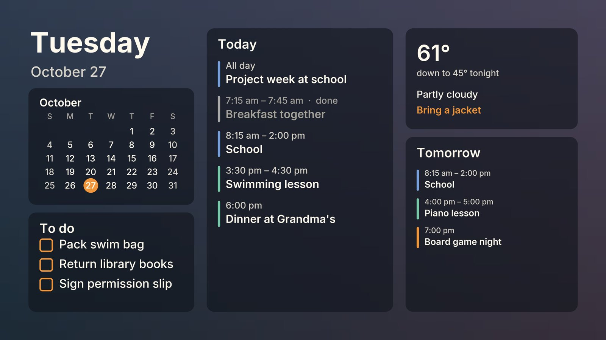

# Frame Daily Plan for Home Assistant

[](https://www.home-assistant.io/)
[](https://github.com/pickerin/hass-frame-daily-plan/releases)

Shows the family's day on a **Samsung The Frame** in Art Mode: today's and tomorrow's events, to-dos, the weather with a "what to wear" hint, and a month calendar. Everything comes from entities you already have in Home Assistant (calendars, to-do lists, a weather entity). When you're done, the artwork and the TV's own slideshow come back exactly as they were.

Local only: the integration talks to the TV over your LAN with the same `samsungtvws` library Home Assistant uses for its own Samsung integration. No Samsung account, no SmartThings, no cloud.



## Features

- **Show plan** renders a 4K image and shows it in Art Mode, remembering the artwork it replaced and pausing the Frame's "Display All" slideshow so it can't rotate the plan away
- **Restore artwork** puts the artwork and slideshow back and deletes the plan image from the TV (only images the integration uploaded are ever deleted)
- **Art Mode switch**: turn Art Mode on or off, and see which it is. Turning it on is idempotent, which makes it safe to call from an "Apple TV went to sleep" automation
- **Daily plan image entity** for a dashboard preview of the last render
- **Options**: which calendars, which to-do lists, which weather entity, 12- or 24-hour times, week starting Monday or Sunday. Temperatures follow your Home Assistant unit system
- Past events turn grey; long titles wrap and shrink; nothing is cut off

Scheduling is left to Home Assistant automations (examples below), so it fits any routine.

## Installation

### HACS

1. HACS, three-dot menu, **Custom repositories**, add `https://github.com/pickerin/hass-frame-daily-plan` as an Integration
2. Install **Frame Daily Plan**, restart Home Assistant

### Manual

Copy `custom_components/frame_daily_plan/` into your `config/custom_components/` folder and restart.

## Setup

1. **Settings, Devices & Services, Add Integration, Frame Daily Plan.** Enter the TV's IP address (give it a DHCP reservation).
2. The TV shows an **Allow this device?** prompt for "Frame Daily Plan". Press **Allow** within two minutes. If you pressed Deny once, remove the device under Settings, Connection, External Device Manager, Device Connection Manager, Device List on the TV, then try again.
3. Open the integration's **Configure** dialog and pick calendars, to-do lists, a weather entity, time format and week start.

Any calendar entity works: iCloud via the CalDAV integration, Google Calendar, Local Calendar, Holiday.

## Entities and services

| Entity | What it does |
|---|---|
| `switch.<tv>_art_mode` | on = showing art, off = TV / HDMI source |
| `button.<tv>_show_plan` | same as the `frame_daily_plan.show_plan` service |
| `button.<tv>_restore_artwork` | same as the `frame_daily_plan.restore_artwork` service |
| `image.<tv>_daily_plan` | last rendered plan |

Services `frame_daily_plan.show_plan` and `frame_daily_plan.restore_artwork` take an optional `device_id` (needed only with more than one Frame).

If the TV is in TV mode when the plan is shown, the plan is queued and appears when Art Mode comes back; it never interrupts a programme.

## Example automations

Weekday mornings, 05:00 to 07:30:

```yaml
alias: Frame - morning plan
triggers:
  - trigger: time
    at: "05:00:00"
    id: show
  - trigger: time
    at: "07:30:00"
    id: restore
conditions:
  - condition: time
    weekday: [mon, tue, wed, thu, fri]
actions:
  - choose:
      - conditions: "{{ trigger.id == 'show' }}"
        sequence:
          - action: frame_daily_plan.show_plan
      - conditions: "{{ trigger.id == 'restore' }}"
        sequence:
          - action: frame_daily_plan.restore_artwork
```

Back to Art Mode when the Apple TV on the Frame goes to sleep (otherwise a Frame hunts for the lost HDMI signal and eventually turns off):

```yaml
alias: Frame - Art Mode when Apple TV sleeps
triggers:
  - trigger: state
    entity_id: media_player.apple_tv
    to: "off"
    for: "00:00:15"
actions:
  - action: switch.turn_on
    target:
      entity_id: switch.frame_tv_art_mode
```

## Notes on The Frame

- Selecting any single image on the TV ends a "Display All" slideshow. The integration restarts the slideshow it found when the plan went up; if you ever lose it, pick Display All on the TV again.
- Art Mode sleep (Art, Sleep Options) only works while the TV is in Art Mode. A Frame left on a dead HDMI input never sleeps; the Apple TV automation above fixes that.
- Tested on a 2024 QN75LS03D (Art API 5.0.1). Other years should work since the library handles both upload methods; please open an issue with your model either way.

## Development

```bash
python3 -m venv .venv && .venv/bin/pip install samsungtvws pillow pytest
.venv/bin/python -m pytest tests
```

The tests cover the pure parts (plan assembly, rendering, the TV transaction) without a Home Assistant install.

## Credits and licence

MIT, see `LICENSE`. The layout, renderer and TV handling are adapted from [JustifyTechExpenses/frame-daily-plan](https://github.com/JustifyTechExpenses/frame-daily-plan) (MIT), a standalone Docker app for the same idea; this integration replaces its web page, scheduler and iCal/Open-Meteo fetching with Home Assistant entities. Fonts are [Inter](https://rsms.me/inter/) (OFL). TV communication uses [samsungtvws](https://github.com/xchwarze/samsung-tv-ws-api) (LGPL-3.0), already bundled with Home Assistant. See `THIRD_PARTY_NOTICES.md`.

Not affiliated with or endorsed by Samsung. "Samsung" and "The Frame" are trademarks of Samsung Electronics.
